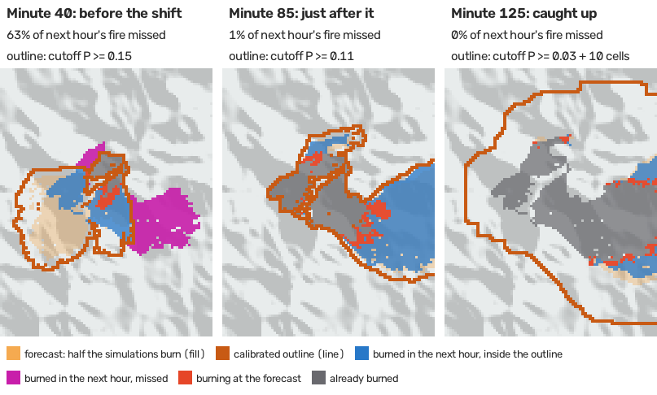
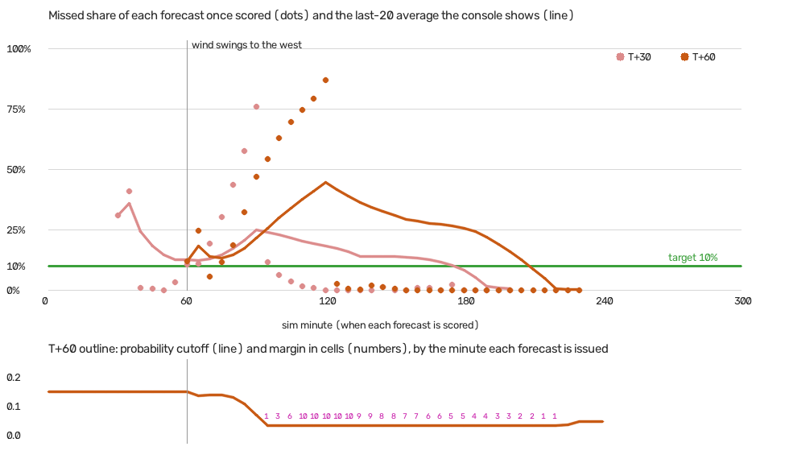

# Fireline AI: models, features and how to read their uncertainty

This page covers everything in the engine that forecasts, recommends, plans or talks, and how to read the uncertainty that comes with each number. The design and the reasons behind it are in `PLAN.md`. Module paths are relative to `engine/`.

**One rule runs through all of it:** every number an operator sees comes from simulating the fire. The language models never invent figures; they only phrase numbers the simulations produced. The learned emulator only draws previews and shortlists crew spots. Nothing it predicts is shown as a result.

## At a glance

| Feature | What it is | Model | Where |
|---|---|---|---|
| Fire forecast | P(burn by T+30 / T+60) for every cell, plus a 10 h forecast for evacuation | Monte Carlo over the stochastic fire model (32 runs), at the wind at issue; optional future-wind scenarios (off) | `forecast/rollout.py`, `forecast/runner.py`, `forecast/wind.py`, `sim/fire.py` |
| Calibrated burn outline | The forecast outline, adjusted so about 90% of new fire lands inside it | Online ACI on a conformal-risk-control (CRC) style missed-area loss | `uq/conformal.py` (`EnvelopeLedger`) |
| Town arrival ranges | "Fire likely arrives in 25–40 min (90%)" | Online conformalized quantiles (CQR) | `uq/conformal.py` (`ArrivalCalibrator`) |
| Evacuation routes | The best way out per town, avoiding roads that will burn by the time traffic gets there | Dijkstra on a burn-risk cost | `routing/evac.py`, `routing/tracker.py` |
| Evacuation order clock | When each town must be ordered out | Fluid traffic queue against forecast fire arrival | `routing/clearance.py` |
| Crew recommendations | Where a crew helps most, with the towns it saves | Paired Monte Carlo what-ifs, emulator shortlist | `forecast/recommend.py` |
| Plan what-ifs | The operator's whole set of orders compared with doing nothing | Paired Monte Carlo | `forecast/plan.py` |
| Learned emulator | An instant forecast preview, and a shortlist of crew spots | U-Net (1.5M parameters; trains with MLX on a Mac or PyTorch on CUDA); optional wind-aware variant (off) | `emulator/` |
| Incident commander Q&A | Typed or spoken questions answered in two sentences | Claude (`claude-haiku-5-5` by default) with 4 simulation tools | `commander/agent.py`, `commander/tools.py` |
| Grounding guard | Rejects any answer with a number no tool produced | Rules | `commander/guard.py` |
| Briefings | Short text alerts in the commander feed ("Paradise is threatened…") | Rules, no LLM | `commander/briefings.py` |
| Dispatch and alert drafts | Unit orders, bilingual evacuation alerts, crew briefings | Templates; Claude rewrites only unit orders and briefings, which must pass the guard | `commander/drafts.py` |

## The foundation: the fire model and Monte Carlo

Everything else builds on a stochastic cellular automaton: each cell is 94 m and each tick is one simulated minute (`sim/fire.py`).
- **Spread:** each tick, a burning cell lights each neighbour with probability `P_H × fuel × slope × wind × (1 − suppression)`.
- **Wind:** the wind term is `e^(C1·v) · e^(C2·v·(cos θ − 1))`, with `C1 = 0.14` and `C2 = 0.3`.
- **Embers:** above 9 m/s, burning cells throw embers downwind.
- **Wind in a forecast:** by default every run keeps the wind at issue for the whole horizon. That is the main reason outlines fail after wind shifts (see "Future wind" below). An optional ensemble gives each run its own plausible wind path instead (`forecast/wind.py`, #228). It is off, because in testing it didn't buy enough coverage for its extra area.
- **Validation:** the constants are checked against two real fires, the 2018 Camp Fire (`eval/campfire.py`) and the 2021 Marshall Fire (`eval/marshall.py`). PLAN.md's "Choosing C2" has the scores.

A **forecast** runs 32 copies of the current fire forward, each with its own random draws, and records when each cell first burned in each run. From that:
- **The burn probability** is the share of runs that burned a cell by T+30 or T+60. The console's forecast "ghost" draws it.
- **Town arrival** is the first time fire touches any cell of a town, in each run.
- **The long forecast** (600 min, 32 runs) feeds the evacuation clock and the arrival ranges.

Forecasts run in worker processes, so they never stall the engine's 10 Hz loop.

**What-ifs are paired.** A "crew here vs no crew" comparison runs both sides on the same random draws (`rollout_paired`). The difference is then the crew's effect, not luck, which makes the estimate far less noisy than comparing two independent forecasts.

## The features

### Evacuation routing (`routing/evac.py`, `routing/tracker.py`)
- **Cost:** each road costs `length × (1 + 8 × P(it burns by the time traffic reaches it))`. Traffic is assumed to move at 25 km/h, as on the jammed roads of 2018.
- **Closed roads:** a road burning now, or at least 90% likely to burn by arrival, is impassable.
- **Status:** a route turns *risky* when its risk is above 25%.
- **Stable routes:** routes don't flicker between runs. A town keeps its route unless that route is cut, or a new one is at least 15% cheaper and the current one has been shown for 20 ticks.
- **Events:** every switch and cut is logged with its reason.

### Evacuation order clock (`routing/clearance.py`)
The clock compares, for each town:
- **Time available:** fire arrival in each run of the 10 h forecast.
- **Time needed:** 20 min to mobilise, then the time for the town's vehicles to drain through its tightest exit road. Road capacity is shared with other towns already ordered out, so ordering Magalia slows Paradise.

**Order-by time:** the latest order time at which, in 90% of simulations, the last car gets out before the fire arrives.

**Statuses:**

| Status | When it shows |
|---|---|
| watch | The order-by time is more than 30 min away, or there's no forecast yet. |
| order soon | The order-by time is within 30 min. |
| order now | The order-by time has passed, but at least half of simulations still get the last car out first. |
| late | The order-by time has passed and fewer than half of simulations get everyone out first. |
| evacuating | The town has been ordered out. |
| trapped | The town has no open exit. |
| clear | Nobody is left in the town. |

If a town takes longer to empty than the 10 h forecast covers, the clock says so instead of claiming a precise time.

### Crew recommendations (`forecast/recommend.py`)
1. **Candidates:** unburned cells on the predicted front, where P(burn by T+30) is between 0.2 and 0.8. They are weighted by nearby population and kept at least a crew's reach apart. With the emulator installed, 48 candidates are screened to 8 in milliseconds.
2. **Score:** each candidate is scored by a paired what-if 2 h ahead. The score is the population-weighted share of each town the fire reaches, plus a small weight on acres, and it accounts for when the crew can actually arrive.
3. **Fresh re-run:** the top 3 are re-run on fresh random seeds. This guards against the winner's curse: the best of 8 noisy estimates is biased upward. If the top two still can't be told apart, both are re-run once more.
4. **Shown only if helpful:** a recommendation appears only if the low end of its 90% benefit interval is above zero.

### Plan what-ifs (`forecast/plan.py`)
The operator's full set of orders is simulated against doing nothing, with each unit acting from when it can actually get there. The result is acres saved, with a 90% interval from the paired differences, and a map of where the plan changes the outcome.

### Learned emulator (`emulator/`)
The emulator is a surrogate for the Monte Carlo forecast: a network trained to output what 64 simulator runs would, in one pass.
- **Architecture:** a U-Net with widths 32–128, three 2× downsamplings, dilated convolutions at 1/8 scale (so each output sees about 160 cells, more than fire can travel in an hour), and GroupNorm.
- **Inputs:** 15 channels:
  - burning, burned, and burn time left;
  - 8 directional spread-times-wind channels: the chance a burning neighbour lights the cell, from fuel, slope and the wind at issue;
  - suppression at +0, 15, 30 and 60 min.
- **Output:** two logits per cell, P(burn by T+30) and P(burn by T+60).
- **Post-processing:**
  - cells already burning are set to 1;
  - cells farther than h king moves from the fire are set to 0, since fire moves at most a cell a minute;
  - T+60 is kept at least as high as T+30.
- **Training:** binary cross-entropy against the 64-run Monte Carlo probability maps, only on the cells in between, with random flips. It trains with MLX on a Mac's GPU or with PyTorch on an NVIDIA GPU (`emulator/backends.py`). The two are the same network and recipe. For the same weights they give the same outputs to within 1e-4 (tested). Weights are always saved in MLX's file layout, which the engine loads.
- **Speed and accuracy:**
  - Speed: about 31 ms per forecast on the full 512 × 480 map on an M2 Max (measured for #229). The 6 ms measured in #113 predates the map's growth. The 32-run forecast takes 0.4–1.5 s.
  - Accuracy: on 342 held-out fires its Brier score against the hedged 64-run label is 0.0038, slightly better than the engine's own 32-run forecast (0.0039).
  - Calibration: in every probability bin the mean prediction is within 0.003 of the label.
  - Overlap: its 50% outline overlaps the engine's forecast by 79%.
- **Wind-aware variant (#229), off:** the same U-Net with 3 more input planes, trained on labels simulated under future-wind scenarios. It turned out no better than the original as a surrogate on wind-shift fires; see "Future wind" under Uncertainty. `EMULATOR=wind` turns it on for previews and screening only.

**Training labels include model error (#170).** Each training sample's 64-run label uses its own `C2` (0.22–0.4, the range the two real fires support) and a ×0.85–1.15 spread rate, and each run draws its own wind (±20% speed, ±15° direction). The inputs stay at the nominal constants, so the emulator learns a forecast that hedges over model error rather than copying one exact setting. The training data covers Paradise and Marshall.

**How to read it:** an emulator preview is a placeholder until the next Monte Carlo forecast lands, usually within a second. Because it hedges over model error, a preview is less sure than the forecast that replaces it: the low-probability fringe (P ≥ 0.1) covers about 27% more ground, and the confident core (P ≥ 0.9) about half as much. That's the hedging, not an error. Previews never feed routes, alerts, the clock, commander answers or the calibrators. While a preview is on screen the forecast's line is the plain 50% edge, not the calibrated outline: the calibration is learned on Monte Carlo forecasts only, so it doesn't apply to the emulator's probabilities. The calibrated line comes back when the Monte Carlo forecast lands.

### Incident commander (`commander/agent.py`, `commander/tools.py`, `commander/guard.py`)
**The model:**
- `COMMANDER_MODEL` (default `claude-haiku-5-5`), with low effort.
- Up to 3 tool rounds and a 10 s answer budget.
- The last 3 question–answer pairs are kept for follow-ups.
- The system prompt names the scenario's real setting (`game.json` `setting`).

**Its four tools:**

| Tool | What it returns |
|---|---|
| `get_situation` | Towns, threats, recommendations and the round. |
| `forecast_whatif` | A 16-run forecast under a different wind. |
| `evaluate_placement` | An 8-run paired what-if for a crew at a given spot. |
| `get_routes` | Routes and the evacuation clock. |

**Grounding guard:** every number in an answer must match a number from this question's tool results, or one the asker said. Rounding the way people speak ("about 230 acres") and turning counts into percentages are allowed. Answers are checked sentence by sentence as they stream. A failed answer gets one correction retry, then the template answer.

**Fallback:** with no API key, a refusal, a network error or a timeout, a rule-based answer is built from the same tools, so the commander never goes quiet.

### Briefings (`commander/briefings.py`)
No LLM is involved.
- **Threatened:** a town is announced as threatened when the low end of its 90% interval on "fire reaches it within 30 min" is at least 50%.
- **Safe again:** only after the interval's high end is below 50% on 2 forecasts in a row. That gap stops a town on the line from flip-flopping.
- **Forecast shift:** announced when the next-hour outline overlaps the previous one by less than 60% (IoU).
- **Pacing:** at most one briefing every 8 s, no repeats about the same town within 45 s, and stale news is dropped.

Every sentence is built from simulation numbers, so briefings are grounded by construction.

### Dispatch and alert drafts (`commander/drafts.py`)
Drafts are written when the operator sends a unit or orders a town out. The operator approves, edits or dismisses each one, and nothing is delivered outside the app.
- **Unit orders and crew briefings:** start as templates. Claude may rewrite them, but a rewrite is kept only if every number comes from the facts and it names no place the facts don't.
- **Evacuation alerts:** stay templated, in English and Spanish, within 360 characters (the Wireless Emergency Alert limit). Public wording and the translation must match exactly.

There is no voice: text-to-speech was removed in #140 and push-to-talk in #175. Questions are typed.

## Uncertainty: three layers, and how to read them

Each layer answers a different question. The console labels them consistently.

### 1. "How sure is this count?": sampling uncertainty (`uq/mc.py`)
Every probability is a count over a few simulations, and a count over 32 runs is itself noisy. The engine gives it a 90% range:
- **Probabilities ("in 24 of 32 simulations")** get a Wilson score interval, sent as `KofN {k, n, lo, hi}`. It stays inside 0–100% and behaves at 0 of 32 or 32 of 32.
  - *Read it as:* "if we ran infinitely many simulations of this same forecast, the share would likely be between lo and hi." For 24 of 32 that's about 61–85%.
- **Confidence words** come from the interval's width:
  - *high:* narrower than 20 points;
  - *moderate:* 20–40 points;
  - *low:* wider than 40 points.

  With 32 runs a mid-range count is usually *moderate*. With 8 runs it's *low*. The commander must say the range or hedge ("probably") unless confidence is high.
- **Benefits** (crew recommendations, plan acres saved) get a Student-t 90% interval on the paired per-run differences.
  - *high:* the low end is at least half the estimate.
  - *moderate:* the low end is above zero.
  - *low:* it isn't shown at all. This is abstention: the engine stays quiet rather than recommend something it can't tell apart from doing nothing.

**What this layer does not cover:** whether the forecast's assumptions hold. More runs only make the estimate of the same model with the same wind more precise.

### 2. "Has this held up so far?": conformal calibration (`uq/conformal.py`)
The raw forecast assumes the wind and the crews stay as they are. Players change both, so the raw outlines turn out overconfident. Two online calibrators check each forecast against what actually happened once its time comes, and adjust.

**The calibrated burn outline (`EnvelopeLedger`).**
- **The target:** of the ground that newly burns in the next 30 or 60 min, on average at most 10% falls outside the outline. This is an average share of *area*, not a promise that the whole fire stays inside (see "Average missed area is not containment" below).
- **How it works:** each outline is scored when its horizon passes, as burned area outside divided by burned area. One knob per horizon moves by `0.1 × (miss − 0.10)`. The knob is a probability cutoff, and when the cutoff can't go any lower it becomes a margin of extra cells, up to 10. This is an adaptive conformal inference (ACI) controller run on a conformal-risk-control (CRC) style loss. The method, a multi-rate alternative that was tested, and what is and isn't guaranteed are in "How the outline is calibrated" below.
- **What kind of guarantee this is:** a finite-sample bound on the *average* miss over the forecasts scored so far. It holds for any sequence of winds and player actions, provided the widest outline is wide enough. It is not a promise about any single outline.
- **On screen:** the map's layers menu shows "Forecast outline: X% at 30 min, Y% at 60 min of new fire fell outside it lately (target 10%)", over the last 20 forecasts. It is highlighted when a recent miss rate is more than 5 points over target.
- **Reading the numbers:** a recent miss rate well above 10% usually means the wind just changed. Expect the outline to widen over the next few forecasts.
- **What it looks like** (`cd engine && uv run python -m eval.envelope_figure`: one Paradise fire on the 512 x 480 map, the wind swinging from north-east to west at minute 60, the engine's own forecaster and calibrator). On the map, the orange **fill** is where at least half the simulations have fire by T+60. That's the raw forecast, not calibrated. The dark orange **line** around it is the calibrated outline.

  

  - **Minute 40, before the shift:** the forecast assumes the old wind, and 63% of the next hour's fire lands outside the outline (magenta).
  - **Minute 85, just after it:** new forecasts already use the new wind and miss 4%. But the forecasts issued before the shift are only scored an hour later, so their misses are still arriving and the outline is just starting to loosen.
  - **Minute 125:** those misses have pushed the knob to its widest (cutoff 1/32 plus 10 cells), so the line sits far outside the fill. It's over-wide now that the forecast has caught up, and it tightens again over the next ~90 minutes.

  

  The miss rate (dots per scored forecast, line for the last-20 average the console shows) spikes about an hour after the shift, and only then does the knob drop to 1/32 and add margin cells. Over this one fire it averages 8.4% at T+30 and 12.2% at T+60. That's the price of a guarantee on the running average with an hour's delay in learning: the outline lags a shift on the way out and stays wide for a while on the way back. Read a wide line next to a tight fill as "the forecast was recently wrong, so give it room", not as a bigger fire.
- **Measured** at `C2` 0.3 on the extended Paradise map, simulator only (`eval.run`, 4 episodes per wind schedule, 83–96 scored forecasts each; missed share over the whole run):

  | Wind | T+30 | T+60 |
  |---|---|---|
  | Steady | 10.9% | 10.9% |
  | Wind shift | 11.7% | 12.6% |
  | Gusty | 12.4% | 12.2% |

  All are inside the finite-sample bound below (about 10% + 3.7/T, so up to about 14% at these T). They sit 1–3 points over target because each run starts from the warm start and spends its first forecasts catching up.
- **Per scenario:** the knob is learned per scenario and restarts from `ENVELOPE_WARM` when the scenario changes.

#### How the outline is calibrated: CRC, ACI and DtACI

**The loss: conformal risk control (CRC) style.** For a forecast issued at time t, let B_t be the ground that newly burns by its horizon and C_t the outline shown. The loss is the share of new fire the outline missed:

```
L_t = |B_t \ C_t| / |B_t|        (in [0, 1]; measured in area, so it means the same at any map resolution)
```

The target is an average L_t of α = 0.10. A forecast where nothing new burns (|B_t| = 0) gives 0/0. It carries no information about missed area, so it is counted (`empty`) and skipped.

- **Why missed area:** an operator cares about how much new fire lands outside the line. One stray burning cell outside and half the head outside should not cost the same.
- **Why not one conformal prediction per pixel:** cells of one fire aren't independent or exchangeable, because spread is contiguous, wind-driven and shared across the whole map. A per-pixel guarantee would hold over pixels pooled across all fires, which isn't a statement about this outline. The area loss is one bounded loss per forecast. It is monotone in the knob: lowering θ only ever adds cells. That is the setting CRC controls (Angelopoulos et al. 2024).
- **What this is not:** CRC as published is a *split* method. It picks the knob from exchangeable calibration data and proves E[L_{n+1}] ≤ α for the next case. Here the knob is learned online from a stream that isn't exchangeable (the wind changes), so the CRC theorem does not apply. Only the loss is borrowed. The closest published method is online risk control (Feldman et al. 2023), which is ACI applied to a bounded risk.

**Nested outlines and loss curves (`envelope_scores`, `ScoreMap`, `RiskCurve`).** Cutoff, then margin, makes the outlines nested in the knob θ. Each cell therefore has a score: the largest θ whose outline still holds it. For a cell with p ≥ 1/32 the score is p. For a cell d king moves outside that set, the score is just below 1/32 − (d − 1) × 0.02. It is −∞ beyond 10 cells. Then C(θ) = {score ≥ θ}, which matches the old cutoff-plus-dilation code exactly (tested). It also means a matured forecast's loss is known at *every* θ, not just the one shown, which gives three things:
- each expert below can be scored on the same forecast;
- the eval can replay any controller on recorded forecasts;
- a forecast where even the widest outline (θ at its floor, 1/32 − 0.2) misses more than 10% is detected and counted (`infeasible`). So are outlines shown at the widest setting (`saturated`).

**ACI, the controller in use (`OnlineEnvelope`, `method="aci"`).** Gibbs & Candès (2021) adjust a miscoverage level online. Here the same update runs on the knob, per horizon:

```
θ ← clip(θ − γ (L_t − α), θ_min, 1),        γ = 0.1,  θ_min = 1/32 − 10 × 0.02
```

Too many misses lower θ, which widens the outline. Feedback is delayed. A T+60 forecast is scored an hour after issue, with about 12 in flight at a forecast every 5 minutes. Each update uses the miss of the outline that was actually shown, and is applied to θ as it is when the score arrives.

**Why one fixed step struggles under abrupt shifts.** One γ trades tracking speed against noise. A small γ is slow to widen after a regime change. A large γ is jumpy in steady wind. The delay makes this worse. After a shift, the hour of forecasts issued under the old wind all mature over the next hour. The controller keeps widening in response to them after the new forecasts, which already use the new wind, no longer need it. It then tightens back at the same fixed rate. The figure above shows this overshoot.

**DtACI-inspired controller, tested but not the default (`DtACIEnvelope`, `method="dtaci"`).** Gibbs & Candès's DtACI (2024) runs k ACI experts with different step sizes and combines them with exponential weights. Here:

- **Experts:** γ_i ∈ {0.0125, 0.025, 0.05, 0.1, 0.2, 0.4}. Each expert is the fixed-step controller with its own knob θ_i, updated on its own counterfactual miss:
  `θ_i ← clip(θ_i − γ_i (L_s(θ_i(s)) − α), θ_min, 1)`.
- **Shown knob:** θ = Σ_i w_i θ_i. This is the deterministic average, the paper's Algorithm 2. The outlines are nested, so any θ in range is a valid outline.
- **Expert loss:** DtACI weights experts by the pinball loss, whose gradient is the ACI step. With a fractional loss, the analogue is the integrated risk

  ```
  f_s(θ) = ∫_{θ_min}^{θ} (L_s(u) − α) du
  ```

  This is convex because L_s is non-decreasing, and its gradient is L_s − α, the controller's own step. For a 0/1 loss it reduces to the pinball loss up to a constant. `RiskCurve.integral` computes it exactly.
- **Weights:** with exponential weights and mixing as in DtACI (fixed share),
  `w_i ← w_i · exp(−η f_s(θ_i(s)))`, then normalized, then `w_i ← (1 − σ) w_i + σ / k`.
  - Defaults: σ = 1/(2I) with I = 20 forecasts. η is the standard fixed-share Hedge step for this loss's worst-case range B = 0.9 × (1 − θ_min): η = √(8 ln(2kI)/I) / B ≈ 1.4 (Herbster & Warmuth 1998; Cesa-Bianchi & Lugosi 2006).
  - The paper's own practical setting was also run: I = 500, σ = 1/1000, and η = √(3/I) · √((log(kI) + 2)/((1 − α)² α²)) ≈ 2.7.
- **Delay:** each matured forecast charges every expert for the knob it held *at issue*, θ_i(s). The step and the reweighting are applied to the current state. No outcome is used before its horizon has passed.
- **Why it might help after wind shifts:** fast experts widen quickly in the burst of misses, and slow experts stay put. The weights could then move to whichever expert has been doing better lately, without committing to one rate.

**Fixes made alongside (#227).**
- *Late scoring:* a forecast that lands after its horizon has passed (slow worker, fast sim) used to be judged on everything burning at scoring time, including fire after its horizon. It is now judged on the engine's burn-tick map, at its own horizon (`mature(..., burn_tick)`).
- *Ordering:* maturities are processed oldest first, ties broken by issue time.
- *Reporting:* empty, saturated and infeasible forecasts are now counted.

#### Statistical guarantees

**Proven, for the ACI controller that is running.** The update telescopes. Write θ_1 for the warm start and T for the number of scored forecasts. Then, for any sequence of winds and actions, with any delays and in any scoring order:

```
(1/T) Σ_t L_t  ≤  α + (θ_1 − θ_min) / (γ T) + E_T / T
```

- E_T is the excess the floor clip absorbed. It is nonzero only on forecasts scored while θ sat at its widest *and* the miss exceeded α. So the bound is clean exactly when the widest outline is wide enough, and the `infeasible` count says when it wasn't.
- At T+30 (θ_1 = 0.2) that is 10% + 3.7/T: within 10 points after 37 scored forecasts, within 1 point after 370.
- It bounds the average over forecasts, each weighted equally, not area pooled across forecasts.
- The same bound holds for each DtACI expert, but only for the losses its own knob *would have* produced.

**Not proven: the DtACI-inspired controller's shown outline.** Gibbs & Candès prove two results for DtACI:
- a long-run coverage bound (their Theorem 3.2), for the randomized Algorithm 1 with η_t and σ_t schedules;
- an interval-regret bound on the pinball loss (Theorem 3.1), which extends to the averaged version (Corollary 3.1).

Both are for 0/1 miscoverage, immediate feedback and unclipped levels, with assumptions on the γ grid. This controller changes the loss, the expert loss, the feedback timing and the clipping. None of those results is claimed for it. (An outer fixed-step correction on the shown loss would restore the telescoping bound; it was not added.)

**Empirically supported** (simulator only, below): average miss near target in steady wind, and the size of the excess under shifts.

**Wind scenarios don't add guarantees.** The bound above holds whatever probability maps the controller is given: constant-wind Monte Carlo, the wind-scenario ensemble, or an emulator. A better forecast can only make it easier to meet with smaller outlines. Sampling future winds makes the maps hedge; it doesn't make them calibrated or give distribution-free coverage (see "Future wind" below).

**Not guaranteed, by either controller:**
- any single outline;
- coverage within a window, e.g. the hour after a shift;
- coverage when the widest outline can't reach 10%;
- anything about real fires (layer 3).

**Average missed area is not containment.** "10% of new burning outside on average" does not mean "a 90% chance the whole fire stays inside." Most outlines have *some* fire outside them. With ACI in the eval, 86% of outlines missed something, the median missed 6%, one in ten missed over 36%, and a few missed everything. The target is about the share of area, averaged over forecasts. There is no per-forecast probability that the outline contains everything.

#### Experimental results: fixed-rate ACI vs DtACI-inspired

`eval.conformal_compare` records each episode's forecasts once, then replays every controller on the identical stream. This is fair: the outline never feeds back into the fire. A test checks that the replay gives the same misses as the live ledger.

**Setup:**
- Paradise, the engine's forecaster at 32 rollouts, a forecast every 5 min for 300 min.
- 8 seeds (0–7) per schedule, the same seeds and ignitions for every controller.
- Schedules:
  - *steady*: 10 m/s throughout;
  - *reversal*: 180° at minute 120;
  - *surge*: 7 → 18 m/s at minute 120;
  - *flipflop*: 180° every 30 min from minute 90;
  - *gusty*: a new random speed and direction every 15 min.
- In the surge schedule, the 2 seeds that start at the fourth ignition point burn out in the light wind before minute 120. Its post-surge numbers therefore come from 6 fires.
- "static" is the warm start, never updated.

Miss is the mean share of new fire outside the outline (target 10%). "Worst 30 min" is the worst run of 6 consecutive scored forecasts, as the console's recent rate would show it, averaged over fires. "vs oracle" is outline area over the area of the tightest outline that would have met 10% on each forecast, in hindsight: 1.0× is as tight as possible, below 1 is too tight.

| Wind | T+30 miss: static / ACI / DtACI | T+60 miss: static / ACI / DtACI | T+60 worst 30 min: ACI / DtACI | T+60 area vs oracle: ACI / DtACI | T+60 shown at widest: ACI / DtACI |
|---|---|---|---|---|---|
| Steady | 10.9 / 9.3 / 9.4% | 7.6 / 8.2 / 8.2% | 24.0 / 23.3% | 1.16 / 1.09× | 0.8 / 0% |
| Reversal | 12.0 / 9.8 / 10.6% | 11.6 / 10.5 / 10.8% | 51.6 / 51.9% | 1.27 / 1.08× | 1.2 / 0% |
| Surge | 13.3 / 10.4 / 11.1% | 12.7 / 11.8 / 12.4% | 54.9 / 55.2% | 2.21 / 1.54× | 10.2 / 0% |
| Flip-flop | 29.0 / 14.8 / 18.9% | 38.7 / 20.2 / 24.0% | 64.4 / 65.3% | 0.93 / 0.72× | 18.6 / 0% |
| Gusty | 24.6 / 13.7 / 16.1% | 25.8 / 15.5 / 18.1% | 40.6 / 42.5% | 1.29 / 0.99× | 8.6 / 0% |

**What this shows:**
- **DtACI-inspired did not beat the baseline on the target.** It missed more in every shifting schedule, by 2.4–4 points under repeated changes. Its outlines were tighter, closer to the hindsight-tightest (0.7–1.5× against 0.9–2.2×), and it never sat at the widest setting.
- **It did not recover faster.** Recovery is the minutes after the shift until the 30-min miss of outlines shown from then on stays within 15%. For the reversal it was 24 min for both at T+60 (static: 38). For the surge it was 28–29 min for all three.
- **So the engine keeps the fixed-rate controller** (`METHOD = "aci"`). DtACI is one argument away (`EnvelopeLedger(..., method="dtaci")`).
- **Why the weights didn't help:**
  - With the worst-case η, the experts' per-forecast loss gaps (median ≈ 0.01) are about 100× below the range η is sized for. The weights stay near uniform, and the output is in effect a plain average of the six experts, whose slow members drag it in shifting wind.
  - Raising η doesn't fix this. It was selected on seeds 0–3 only, over η × {1, 3, 10, 30, 100, 300}. T+60 miss rose from 14.7% to 16.6%, against the baseline's 13.3%. With an hour's delay, the weights chase whichever expert would have done well an hour ago.
  - The paper's own setting (I = 500) gave 13.0% / 14.6% pooled, against ACI's 11.6% / 13.1%.

**What actually drives the drop after a wind shift.** The table below uses no controller, only the warm-start cutoff. T+60 forecasts, pooled over fires:

| | Issued in the hour *before* the shift ("stale") | Issued in the hour after ("fresh") |
|---|---|---|
| Reversal: miss at the warm cutoff | 26.7% | 10.8% |
| Surge: miss at the warm cutoff | 45.1% | 9.4% |
| Surge: widest outline still misses > 10% (cap 10 / 20 / 40 cells) | 58% / 29% / 0% of forecasts | 8% / 8% / 6% |

- **The bad outlines are the ones already shown when the wind changed.** Forecasts made after the shift already use the new wind, and they are about on target before any calibration. The outlines that fail were made under the old wind, and their outcomes only arrive up to an hour later.
- **No online calibrator can fix that, faster or not:** the shift isn't predictable from past misses. That's why every controller, static included, has about the same worst 30-minute window at T+60 (52% for the reversal, 54–55% for the surge).
- **What the calibrator controls:**
  - how wide it is *before* a shift, which it learns in regimes where shifts recur (flip-flop and gusty: 20% and 16% miss with ACI, against 39% and 26% static);
  - how much it over-widens afterwards (ACI's 2.2× in the surge; DtACI's 1.5×).
- **The 10-cell margin cap matters only for strong surges.** Raising it to 20 lowered ACI's pooled T+60 miss from 13.1% to 12.5% but grew outlines from 1.40× to 1.65× the hindsight-tightest, so the cap was left at 10.
- **Fixing the shift itself needs a wind forecast,** or an outline that already prices in the chance of a shift. Calibration can't supply either.

Full tables, including the per-horizon recovery times, the I and η sweeps and the cap-20 variants, are in `docs/conformal_compare.md`. Regenerate them with:

```sh
cd engine
uv run python -m eval.conformal_compare --episodes 8 --cache /tmp/streams.pkl --out ../docs/conformal_compare.md
# ~10 min to record on 6 workers; replaying a cached recording takes seconds
```

**References:**
- A. N. Angelopoulos, S. Bates, A. Fisch, L. Lei, T. Schuster. *Conformal Risk Control.* ICLR 2024 (arXiv 2208.02814).
- I. Gibbs, E. Candès. *Adaptive Conformal Inference Under Distribution Shift.* NeurIPS 2021 (arXiv 2106.00170).
- I. Gibbs, E. Candès. *Conformal Inference for Online Prediction with Arbitrary Distribution Shifts.* arXiv 2208.08401 (2022; v3 2023). Algorithms 1–2, Theorems 3.1–3.2.
- S. Feldman, L. Ringel, S. Bates, Y. Romano. *Achieving Risk Control in Online Learning Settings.* TMLR 2023.
- M. Herbster, M. Warmuth. *Tracking the Best Expert.* Machine Learning 32, 1998.
- N. Cesa-Bianchi, G. Lugosi. *Prediction, Learning, and Games.* Cambridge, 2006.

#### Future wind: the wind-scenario ensemble (#228) and the wind-aware emulator (#229)

**Why constant wind fails.** Every forecast run assumes the wind at issue holds for the whole horizon. When the wind turns, all 32 runs are wrong in the same way, so the probability map is confidently wrong. No conformal controller can repair outlines that were already shown (previous section). The only place to act is at forecast time: let the runs disagree about the future wind.

**How future wind is sampled (`forecast/wind.py`).** Each run gets its own minute-by-minute wind path, built from the wind at issue only (speed v₀, direction d₀):
- **Slow wander:** offsets in direction (δ) and log-speed (s) follow AR(1) processes that start at zero:

  ```
  δ_{t+1} = ρ δ_t + √(1 − ρ²) · σ_d · ε,    ρ = e^(−1 min / 60 min),  σ_d = 15°   (s likewise, σ_s = 0.15)
  ```

  Minute to minute the wind is strongly correlated. The spread grows with lead time (σ_d · √(1 − ρ^(2t))), so the next few minutes look like now and the hour ahead doesn't.
- **Abrupt shifts:** Poisson, at 0.25 per hour, so about 1 run in 5 sees one within the hour. A shift turns the wind by a uniform 30–180° either way, and scales its speed by a lognormal factor (σ 0.4, about ×0.67–1.5). The wander then continues around the new wind.
- **Gusts:** in any minute, a 5% chance of +30% speed.
- **Into the fire model:** the runs feed their wind to the same fire kernel, tick by tick. Ember spotting follows each run's own wind too.
- **What the sampler assumes:**
  - The scenarios ship no weather forecast, so the centre is persistence of the current wind.
  - The parameters are a scenario prior (what changes are plausible in a round), not fitted to observed weather. The ensemble is a scenario model, not a calibrated meteorological forecast.
  - Nothing about the eval's wind schedules is coded into it.
  - A forecast sees only the snapshot at issue. A test checks that two fires with identical pasts and different futures get identical forecasts.

**What it does to the probability maps.** A cell's probability becomes the share of runs that burn it under their own wind. So it now mixes two uncertainties:
- the fire's own randomness (spread and ember draws, which is all the constant-wind forecast has);
- the wind's.

Runs whose wind turned spread fire in other directions. That adds a thin low-probability fringe in those directions and shrinks the confident core. With 32 runs and about 1 in 5 seeing a shift, each pointing its own way, any particular shift (say, a reversal) is usually represented by one or two runs: a probability of 1/32 to 2/32. That is often below the cutoff the controller uses. The ensemble hedges against shifts in general, not against the one that happens.

**How the conformal controller calibrates it.** Nothing changes in the controller: the same CRC-style missed-area loss, the same fixed-rate ACI update and 10% target. Each forecaster gets its own controller state from the same warm start, and nothing learned on one is reused for another. The ensemble only changes the probability maps whose cutoff and margin the controller tunes. Ensemble probabilities are not calibrated by construction (they are only as good as the scenario prior), which is why the controller still sits on top.

**The wind-aware emulator (#229).** The emulator learns to output the ensemble's map in one pass.
- **Labels:** 64-run maps simulated under wind scenarios, with the model-error hedging the original labels already had (`C2`, spread rate).
  - Each training fire draws its own uncertainty level: shift rate 0–1 per hour, direction wander 5–30°, speed wander 0.05–0.3.
  - 20% of fires get none, and their label is exactly the original constant-wind label.
- **Inputs:** the original 15 channels, all as at issue, plus 3 constant planes holding that uncertainty level (`features.wind_code`).
  - The model never sees a future wind, only how uncertain the future is assumed to be, and it learns the spread of outcomes that implies.
  - That differs from the original labels' per-run wind perturbation (±15°, ±20%, fixed for a whole run), which can't represent a wind that changes partway through a forecast.
- **Data and training:** 3,063 training and 301 held-out test fires, generated separately (seeds 2 and 3; fires that burn out before the snapshot are skipped). Trained for 12 epochs at batch 16 with the original recipe, on PyTorch/CUDA (an RTX A6000). The original model saw about 5,200 training fires, so the comparison below is confounded by data size.

**Guarantees and measurements, kept apart:**
- **Guaranteed:** only the ACI bound in "Statistical guarantees" above. Whichever forecaster feeds it, it bounds the average missed area of the outlines shown, provided the widest outline is wide enough. It says nothing about how good the probabilities are.
- **Not guaranteed:**
  - that ensemble probabilities are calibrated (they inherit the scenario prior);
  - that the emulator matches the ensemble (it's an approximation, measured below);
  - any distribution-free coverage from adding scenarios;
  - whole-fire containment.
- **Measured, simulator only:** everything below. These say how the methods behave against our own fire model with scripted winds, not against real fires.

**Evaluation protocol** (`eval.wind_ensemble`, built on `eval.conformal_compare`).
- **Fires:** Paradise, with a forecast every 5 min for 300 min. All forecasters forecast from the same snapshots of the same fires.
- **Reproducibility:**
  - Recordings on the Linux server and on the Mac were checked to give bit-identical constant-wind episodes (fires and forecasts).
  - A second server run of the 48 fires reproduced all 48 constant-wind episodes exactly, and 47 of 48 ensemble episodes. In the one exception, a single late forecast differed. The cause isn't pinned down (rare floating-point differences in vectorized math are a guess).
  - The tables use the first run.
- **Schedules:** steady, veer (a gradual 90° turn), reversal, surge (7 → 18 m/s), flip-flop and gusty.
- **Tuning:** the shift rate was chosen on seeds 0–3 by a rule fixed beforehand: the least outline area at a pooled 10% miss, relative to constant wind. It picked 0.25/h. The higher rates cut pre-shift misses there, but cost about 16% more area.
- **Final run:** seeds 4–11, 48 fires, reported here.
- **Pre-shift:** forecasts issued in the h minutes before an abrupt shift (reversal, surge, flip-flop).

**Held-out results, Monte Carlo** (seeds 4–11). "Equal risk" uses no controller: the cutoff at which the pooled miss is 10%, and the outline area needed there.

| | T+30 constant | T+30 ensemble | T+60 constant | T+60 ensemble |
|---|---|---|---|---|
| Equal risk: area for a pooled 10% miss | 12.8 km² | 13.3 km² | 44.9 km² | 45.4 km² |
| Equal risk: pre-shift miss | 20.5% | 20.3% | 24.2% | 25.3% |
| Under ACI: mean miss | 10.8% | 10.4% | 11.9% | 10.8% |
| Under ACI: pre-shift miss | 15.0% | 14.7% | 24.9% | 22.6% |
| Under ACI: mean outline area | 16.6 km² | 17.7 km² | 45.1 km² | 89.7 km² |
| Under ACI: surge outline area | 32.5 km² | 37.9 km² | 96.6 km² | 282.4 km² |
| Forecast time (server CPU, mean) | 1.5 s | 3.5 s | | |

- **The selected ensemble doesn't fix the pre-shift failure.** At equal risk it is area-neutral but no better before shifts. Under the controller, it lowers T+60 misses by about 1–2 points but doubles the outline area, mostly in the surge (rollouts at 18 m/s with random shifts sprawl).
- **That is not a better trade-off than constant wind, so constant wind stays the default** (`runner.WIND_MODEL = None`).

**Held-out results, emulators** (`emulator.evaluate --compare`, 301 test fires; open cells only). Brier score is mean squared error (lower is better). Calibration error is the mean |prediction − label| gap across probability bins (lower is better). IoU is the overlap of 50% areas (higher is better).

| Predictor | Brier vs wind-scenario label | Calibration error | IoU | Brier vs constant-wind label |
|---|---|---|---|---|
| Original U-Net (#192 weights) | 0.00370 | 0.0056 | 0.778 | 0.00373 |
| Wind-aware U-Net | 0.00363 | 0.0003 | 0.770 | 0.00428 |
| 32-run Monte Carlo, constant wind | 0.00313 | 0.0132 | 0.844 | 0.00333 |
| 32-run Monte Carlo, wind scenarios | 0.00207 | 0.0044 | 0.852 | 0.00288 |

- **On fires whose label carries wind uncertainty (236 of 301),** the wind-aware U-Net's Brier is 0.00340 against the original's 0.00366. On the 65 constant-wind fires it is worse: 0.00438 against 0.00383.
- **Speed:** both U-Nets take about 31 ms per forecast on an M2 Max.

**Emulators on the same 48 wind-shift fires,** each with its own ACI state:

| T+60 | Mean miss | Pre-shift miss | Mean outline area | Recovery after a shift | Equal-risk area |
|---|---|---|---|---|---|
| Monte Carlo, constant | 11.9% | 24.9% | 45.1 km² | 29 min | 44.9 km² |
| Monte Carlo, ensemble | 10.8% | 22.6% | 89.7 km² | 29 min | 45.4 km² |
| Original U-Net | 10.7% | 22.2% | 44.0 km² | 45 min | 32.1 km² |
| Wind-aware U-Net | 11.1% | 22.4% | 57.8 km² | 42 min | 36.4 km² |

T+30 is similar: miss 10.0–10.8% for all four, outline area 16–18 km².

**Is the wind-aware U-Net a useful surrogate?**
- **As an approximation of the ensemble: partly.**
  - It is better calibrated than the original U-Net against ensemble labels.
  - Its Brier is slightly better against those labels (7% on wind-uncertain fires), but its 50% outline overlap is slightly worse.
  - It is clearly worse than the original where the wind holds.
  - It is well short of a 32-run ensemble forecast (Brier 0.00363 against 0.00207).
- **As a forecaster under the controller: no gain.** On the 48 fires it needs more area than the original U-Net for about the same misses.
- **Speed:** both U-Nets are about 50–100× faster than Monte Carlo. The runtimes are on different hardware (a Mac GPU against server CPUs), so take the ratio as rough.
- **The data-size confound** (3,063 against about 5,200 training fires) may explain part of the gap.
- **Both U-Nets recover more slowly after a shift** (42–45 min against 29). Recovery is the minutes until the 30-min miss of outlines shown after the shift stays within 15%. A preview's line is the plain 50% edge in the console anyway (see "Learned emulator").
- **Neither changes production.** The original U-Net stays the preview model; Monte Carlo stays authoritative.

**Exploratory, not validated: a 1/h shift rate.** This was looked at only after the held-out result above was known, because the higher rates had cut pre-shift misses in tuning. It was not chosen by the tuning rule, and it is measured on the same seeds 4–11, so treat it as a hypothesis for a fresh test, not a result.

| Seeds 4–11 | T+30 constant | T+30 ensemble, 1/h | T+60 constant | T+60 ensemble, 1/h |
|---|---|---|---|---|
| Equal risk: area for a pooled 10% miss | 12.8 km² | 14.5 km² | 44.9 km² | 51.6 km² |
| Equal risk: pre-shift miss | 20.5% | 17.5% | 24.2% | 20.7% |
| Under ACI: mean miss | 10.8% | 10.3% | 11.9% | 10.7% |
| Under ACI: pre-shift miss | 15.0% | 13.8% | 24.9% | 19.6% |
| Under ACI: mean outline area | 16.6 km² | 21.9 km² | 45.1 km² | 138.4 km² |

- **Equal risk:** with no controller, the 1/h ensemble cuts pre-shift misses by 3–3.5 points for about 14% more area. That matches what tuning showed for the higher rates, so the trade looks real.
- **Under ACI:** its T+60 outlines are three times the constant-wind area. The controller widens the hedged maps a lot more than it widens constant-wind ones.
- **The wind-aware U-Net, given 1/h as its input,** follows its Monte Carlo counterpart in direction. At equal risk its pre-shift miss falls from 20.1% to 18.9% (T+30) and from 27.1% to 24.7% (T+60), at about the same area.
- **Verdict:** a fresh test on new seeds would be needed before calling this an improvement. Even then the controller's area cost at T+60 is a problem to solve first. The setting stays off.

**Limitations.**
- **The truth is our own simulator.** Wind changes are scripted and the fire model is the same one that forecasts, so this measures the value of hedging over future wind, not real-world skill (layer 3).
- **The scenario prior isn't fitted to weather data.** A real wind forecast (direction-change likelihoods, frontal timing) is what would help pre-shift outlines most. The sampler takes one as its centre trivially, if one ever exists.
- **32 runs spread thin over many possible shifts,** so the ensemble rarely puts much probability on the shift that actually happens. More runs cost linearly more time, and the ensemble is already about 2× slower.
- **Ensemble outlines can grow very large in strong winds** (surge), which hurts more than the hedging helps.
- **Emulator caveats:** the wind-aware emulator's training set was smaller than the original's, and both emulators were evaluated on Paradise only. The test fires come from the training distribution (both maps), not from unseen scenarios.

**Reproduce:** `docs/wind_experiments_runbook.md` has every command and the server/Mac split. Reports: `docs/wind_ensemble_tune.md`, `docs/wind_ensemble.md`, `docs/emulator_compare.json`.

**Town arrival ranges (`ArrivalCalibrator`).**
- **Raw range:** each threatened town gets the 5–95% range of fire arrival across the long forecast's runs.
- **Correction:** a learned correction Q per lead-time bucket (under 30 min, 30–120 min, over 120 min) widens or narrows it to `[lo − Q, hi + Q]`.
- **Calibration units:** towns burn too rarely to learn from, so Q is learned on town-sized disks (8-cell radius) dropped on unburned ground and scored like towns. The bound below applies to those disks; that towns behave like them is an assumption, which the measured town coverage checks.
- **On screen:** "fire likely arrives in 25–40 min (90%)". There is no range (null) when too few simulations reach the town to bound it. That means "probably not within the forecast", not "never".
- **Measured coverage** of real town arrivals (target 90%, `eval.arrival`, 40–55 town ranges per schedule) on the extended map: steady wind 95% (median width 36 min), gusty 65% (164 min), wind shift 67% (63 min).
- **Wind shifts:** treat ranges issued just before a shift as stale. They learn only after the shift, and the fix for that is a real wind forecast, not more statistics.

**The guarantee, precisely.** Split conformal prediction gives a finite-sample guarantee for each new prediction, P(covered) ≥ 90%, but only if the calibration data and the new case are exchangeable. A fire under shifting wind and player actions isn't, so the console uses the online (ACI) form instead. That trades the per-prediction guarantee for a deterministic one on the running average, with no assumption about the data at all:
- **Arrival ranges (`OnlineQuantile`, no clipping):** each update moves Q by `lr × (miss − 0.10)`, so the sum telescopes: after T scored disks in a bucket, |miss rate − 10%| = |Q_T − Q_0| / (lr × T). Q stays within about the largest score (the forecast horizon), so the gap shrinks like 1/T. It holds at every T, not just in the limit, but it is loose early on.
- **Burn outline (`OnlineEnvelope`, knob clipped to [1/32 − 0.2, 1]):** the same telescoping, with a term for what the floor clip absorbs. See "Statistical guarantees" above.
- **What it doesn't promise:**
  - any single outline or range;
  - coverage in a particular window, such as the 20 forecasts right after a wind shift (the "short catch-up");
  - town coverage directly, since the arrival bound is on the disks.

  Those are why the measured numbers above are reported next to the bound. Outline misses are also averaged per forecast, not weighted by area.

**Caveat on censoring:** a disk that never burns within the forecast counts as the smallest miss it could be. That can only make ranges too narrow, never too wide. It's counted and reported (`cells_censored` in `eval.arrival`).

### 3. "Is the simulator right about real fires?": model error
Layers 1 and 2 measure the simulator against itself plus changes in wind and crews. Whether the simulator matches real fire behaviour is checked separately:
- **Real-fire replays:** the Camp Fire and Marshall Fire replays score the model against real perimeters and timed observations. On the full 512x480 map, the Camp Fire replay overlaps the real perimeters at IoU 0.35 / 0.46 and burns about twice the real area (the earlier 0.66 / 0.78 was inside a smaller map whose edges hid the over-burn). It still gets the direction and the threatened towns right: the evacuation clock flags all 4 towns the real fire reached, before the real deadline. Marshall's 2.5 h outline matches the real area (IoU 0.45, 1.01×).
- **Emulator training:** the emulator's labels average over plausible model constants, so its previews hedge over this error.
- **Known gaps:**
  - no fuel moisture or humidity model, the likely reason the Camp Fire replay over-burns the foothills about 2×;
  - suburbs burn like fuel, with no house-to-house spread, so Marshall overshoots past where the real fire stopped;
  - no wind forecast, so the wind is assumed to hold unless the operator asks a what-if.

## Cheat sheet for operators

| You see | It means |
|---|---|
| "in 24 of 32 simulations" | 24 of 32 simulated futures did this. The true chance is likely 61–85%. |
| confidence: moderate / low | The count is too small to be sharp. Read it as a range, not a number. |
| A forecast outline with a miss rate near 10% | The outline has been honest lately. |
| A miss rate well above 10% | Something changed, probably the wind. The outline is catching up. |
| "fire likely arrives in 25–40 min (90%)" | A range whose miss rate is held near 10% on average over the session. Measured on towns it holds about 9 times in 10 in steady wind, but it's weaker right after a wind shift. |
| No arrival range | Too few simulations reach the town to bound it. |
| A crew recommendation | Even its pessimistic estimate helps. Weaker spots are hidden. |
| A preview that snaps to a slightly different shape | The emulator's instant guess being replaced by the full forecast. |
| A commander answer | Every number in it came from a simulation run for that question. |

## Checking it yourself

```sh
cd engine
uv run python -m eval.run            # forecast skill, envelope miss rate, routing, recommendations (~75 s)
uv run python -m eval.arrival        # arrival-range coverage per wind schedule (~15 min)
uv run python -m eval.conformal_compare --cache /tmp/streams.pkl   # outline calibration: fixed-rate ACI vs DtACI under wind shifts (~10 min)
uv run python -m eval.wind_ensemble --phase final --cache wind_final.pkl   # constant wind vs the wind-scenario ensemble (big CPU job; see docs/wind_experiments_runbook.md)
uv run --extra ml python -m emulator.evaluate --compare --test emulator/data/test_wind   # original vs wind-aware emulator vs Monte Carlo
uv run python -m eval.campfire       # the Camp Fire replay (~3 s)
uv run python -m eval.marshall --measured   # the Marshall Fire replay
uv run python -m eval.early_attack   # does crew dispatch contain fires at 3/8/13 m/s
uv run python -m eval.evac_clock     # order-by times against the Camp Fire's real arrivals
uv run --extra ml python -m emulator.evaluate   # emulator Brier, IoU, calibration, speed
uv run python -m commander.ask "What if the wind shifts west?"   # one commander answer, with tools and timing
```

The `model-eval`, `fire-emulator`, `tune-fire` and `commander` skills in `.claude/skills/` have the details.
